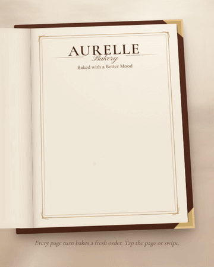

# AURELLE Bakery Menu

An interactive dessert menu book for a fictional bakery. Each tap turns a page in 3D, and the next dessert bakes onto the page out of swirling flour and sparkles.



Full demo video: [media/aurelle-demo.mp4](media/aurelle-demo.mp4)

## Features

- An open menu book lying on a marble table, with a leather cover, gold corners and a framed paper page
- 3D page turns forward and back
- A flour-and-sparkle particle effect drawn on canvas as each dessert appears
- Autoplay, plus tap, swipe and arrow-key navigation
- Plain HTML, CSS and JavaScript, with no build step and no dependencies

## Run it

Open `index.html` in a browser, or serve the folder:

```bash
npx serve .
```

## Project structure

```
index.html              page, styles and script
assets/desserts/*.webp  dessert images with transparent backgrounds
media/                  demo video, GIF and preview image
```

## Credits

The concept and the dessert imagery come from an Instagram reel by [@vexmo_animation](https://www.instagram.com/vexmo_animation/). This project recreates that reel's concept as an interactive web page.
